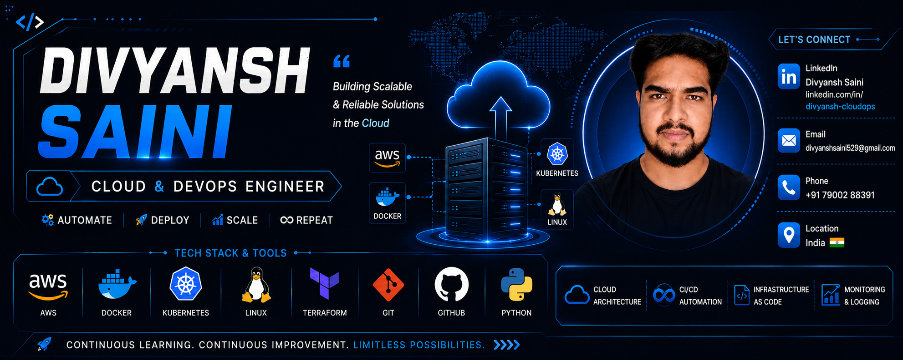

  
 <h1 align="center">Hi 👋, I'm Divyansh Saini</h1> <h3 align="center"> ☁️ Cloud & DevOps Engineer &nbsp;•&nbsp; AWS &nbsp;•&nbsp; Docker &nbsp;•&nbsp; Kubernetes &nbsp;•&nbsp; Terraform </h3> 
  
 
     
 
🚀 About Me
<table> <tr> <td width="190" align="center" valign="top">   <b>Divyansh Saini</b>  Cloud & DevOps Engineer </td> <td valign="top">
yaml
name:       Divyansh Saini
role:       Cloud & DevOps Engineer (DevOps Intern @ 10xTechHub)
education:  B.Tech CSE @ Roorkee Institute of Technology (2023 - 2027)
location:   India 🇮🇳
focus:      AWS • Terraform • Docker • CI/CD • Cloud Security
learning:   [ECS, Kubernetes, Jenkins, GitHub Actions, Docker Compose]
goal:       Become a Professional Cloud & DevOps Engineer
</td> </tr> </table>

I build secure, scalable and automated cloud environments on AWS using Terraform, Docker and CI/CD pipelines, with hands-on experience in cloud security, monitoring and cost optimization.

⚡ How I Ship
feedback
💻 Git Push
⚙️ GitHub Actions / Jenkins
🐳 Docker Build
🏗️ Terraform Apply
☁️ AWS: EC2 · VPC · ALB
📈 CloudWatch · CloudTrail· Config
🛠️ Tech Stack

  

☁️ Compute & Network	🗄️ Storage & DB	📈 Monitoring	🔐 Security
EC2 · ECS · Lambda	S3 · EBS · RDS	CloudWatch	IAM · KMS · MFA
VPC · ALB · Auto Scaling	CloudFront	CloudTrail	AWS Config
Elastic Beanstalk		AWS Budgets	Security Groups
⚙️ DevOps	💻 Programming & OS	🌿 Version Control
Docker · Docker Compose	Python · Bash	Git
Kubernetes (Fundamentals)	Linux	GitHub
Terraform · Jenkins · GitHub Actions		
💼 Experience
🚀 DevOps Intern — 10xTechHub

📍 Remote (Hyderabad, India)  •  🗓️ March 2026 – May 2026

🔄 Assisted in designing and maintaining CI/CD pipelines with Jenkins and GitHub Actions
🖥️ Managed and monitored Linux servers and cloud infrastructure for reliability and uptime
🐳 Containerized applications with Docker; hands-on with Kubernetes fundamentals
🤝 Collaborated via Git/GitHub, troubleshooting deployments and optimizing workflows
☁️ Used AWS and monitoring tools while applying IaC and automation best practices
📌 Featured Projects
<table> <tr> <td width="50%" valign="top">
🔐 AWS Security Hardening & Cost Optimization

AWS IAM EC2 S3 EBS Config CloudTrail CloudWatch Budgets

Built an end-to-end AWS security audit environment
Fixed 5 critical issues: public S3, over-permissive IAM, unencrypted EBS, exposed Security Groups, no MFA
Applied least-privilege IAM, MFA, Block Public Access, KMS
Enabled Config + CloudTrail + CloudWatch; tracked cost with Budgets

Repo

</td> <td width="50%" valign="top">
🏗️ AWS VPC + EC2 + Nginx (Terraform)

AWS Terraform VPC EC2 Nginx IAM Security Groups

Provisioned custom VPC, subnets, routes and IGW via Terraform
Fully automated EC2 + Nginx deployment
Modular, reusable .tf files to avoid config drift
Locked down to HTTP/SSH with least-privilege access

Repo

</td> </tr> </table>

🧪 More hands-on labs

Project	Description
☁️ AWS EC2 Web Server	Apache web server on EC2
🐳 Docker Projects	Docker hands-on labs
☸️ Kubernetes Labs	Pods, Deployments & Services
⚙️ Jenkins	CI/CD pipelines
🐧 Linux	Commands & administration
🐍 Python	Automation scripts
📊 GitHub Analytics

   
 
  

📚 Currently Learning
☁️ AWS ECS
☸️ Kubernetes
🏗️ Terraform
⚙️ Jenkins & GitHub Actions
🐳 Docker Compose
🐧 Linux Shell Scripting
🎓 Education

B.Tech in Computer Science & Engineering — Roorkee Institute of Technology, Roorkee  •  2023 – 2027

🌐 Connect With Me

   
 
⭐ If you like my work, don't forget to star my repositories ⭐
 
